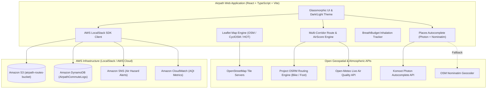
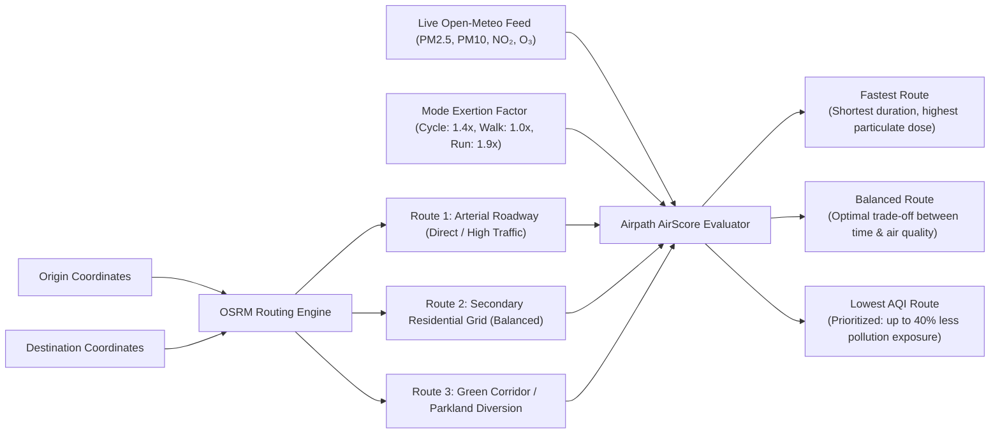
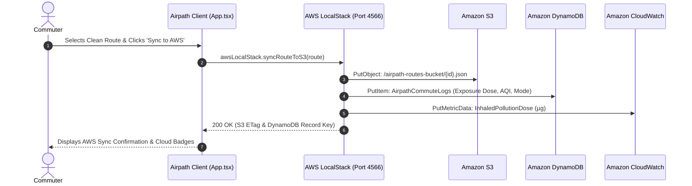
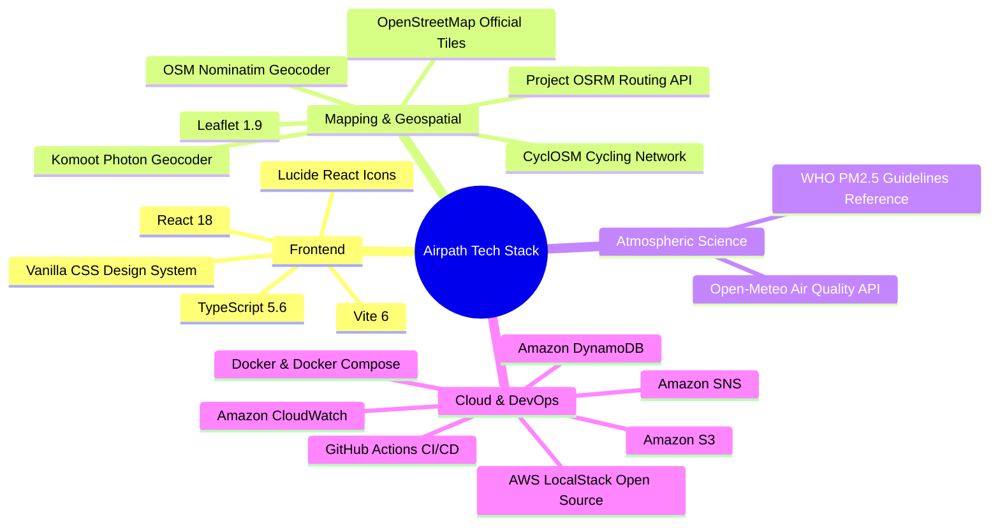

<div align="center">

# 🌿 Airpath — Smart Commute Router

### Real-Time Air Quality-Aware Commute Planning Engine

[](https://www.typescriptlang.org/)
[](https://react.dev/)
[](https://vitejs.dev/)
[](https://leafletjs.com/)
[](https://www.openstreetmap.org/)
[](https://localstack.cloud/)
[](LICENSE)

<p align="center">
  <b>Traditional navigation systems optimize exclusively for speed, routinely channeling cyclists, runners, and pedestrians onto high-density, exhaust-choked arterial highways.</b><br>
  Airpath transforms urban mobility by routing active commuters through cleaner air corridors — lowering particulate inhalation by up to <b>40%</b> with negligible time compromise.
</p>

[Key Features](#-key-features) • [Architecture](#-system-architecture) • [AWS Integration](#-aws-open-source--cloud-architecture) • [UX Design](#-product-design--the-30-laws-of-ux) • [Quick Start](#-quick-start) • [Repository Structure](#-repository-structure)

---

</div>

## 📌 Executive Summary

Urban air pollution kills an estimated 7 million people annually. Active commuters (cyclists, pedestrians, and runners) breathe up to **3–4× more air per minute** due to physical exertion, multiplying their cumulative toxic dose of particulate matter (**PM2.5**, **PM10**), nitrogen dioxide (**NO₂**), and ground-level ozone.

**Airpath** is a full-stack, open-source commute platform that solves this challenge through:
1. **Three-Corridor Routing Engine**: Simultaneously calculates the **Lowest AQI Route** (green canopy path), **Balanced Route**, and **Fastest Route** using real OpenStreetMap road geometry via OSRM.
2. **Live Atmospheric Sensing**: Connects directly to the **Open-Meteo Air Quality API** for real-time particulate and chemical readings with zero API key dependencies.
3. **Global & Regional Autocomplete**: Powered by **Komoot Photon** and **OSM Nominatim** with smart 120 km metropolitan proximity ranking and category tagging.
4. **BreathBudget™ Personal Exposure Ledger**: Tracks cumulative daily pollutant inhalation against World Health Organization (WHO) safety thresholds.
5. **AWS Open-Source Cloud Infrastructure**: Fully integrated with **AWS LocalStack** and cloud services (**Amazon S3**, **Amazon DynamoDB**, **Amazon SNS**, and **Amazon CloudWatch**).

---

## 🏗️ System Architecture

Airpath utilizes a modern micro-services architecture powered by open geospatial standards and AWS cloud primitives.



---

## ⚡ 3-Route Decision Engine & AirScore Pipeline

Rather than returning a single path, Airpath's proprietary scoring engine evaluates candidate street vectors across multiple trade-off dimensions:



### Route Scoring Metric Formula
$$\text{AirScore} = 100 - \min\left(100, \frac{\text{AQI}}{3} + \text{Duration}_{\text{min}} \times 0.6 \times \text{ExertionMultiplier}\right)$$

* **Lowest AQI Route**: Prioritizes low-traffic, canopy-covered corridors, lowering particulate exposure.
* **Balanced Route**: Negotiates secondary streets with modest detours (+3 to +5 min).
* **Fastest Route**: Direct arterial transit for commuters where absolute speed is required.

---

## ☁️ AWS Open Source & Cloud Architecture

Airpath is architected for zero-cost local development and frictionless cloud deployment using **LocalStack** and **AWS SDK v3**.



### AWS Services Employed

| Service | Architecture Role | LocalStack / Cloud Target |
| :--- | :--- | :--- |
| **Amazon S3** | Object storage for geo-referenced route JSON payloads, turn vectors, and GPX tracklogs. | Bucket: `airpath-routes-bucket` |
| **Amazon DynamoDB** | Low-latency NoSQL table storing user commute exposure histories and cumulative BreathBudget logs. | Table: `AirpathCommuteLogs` (PK: `userId`, SK: `timestamp`) |
| **Amazon SNS** | Pub/Sub notification engine pushing alerts when atmospheric AQI breaches hazardous thresholds (>200). | Topic: `airpath-aqi-alerts` |
| **Amazon CloudWatch** | Aggregates time-series commuter metrics: total particulate dose inhaled, minutes routed, and clean air savings. | Metric: `InhaledPollutionDose`, `CleanAirSavedPercent` |

---

## 🌟 Key Features

### 1. Interactive Multi-Layer OpenStreetMap Canvas
- Built with **Leaflet.js** using official vector and raster tile servers.
- **Interactive Layer Switcher**:
  - 🗺️ **OpenStreetMap Standard**: High-contrast, globally consistent street network.
  - 🚲 **CyclOSM**: Dedicated bicycle infrastructure, dedicated cycleways, and surface ratings.
  - 🌍 **Humanitarian (HOT)**: Enhanced contrast and clarity for urban density.
- Smooth camera panning, interactive route selection, and distinct color-coded route overlays.

### 2. Global & Regional Autocomplete Search
- Dual-engine fallback powered by **Komoot Photon** and **OpenStreetMap Nominatim**.
- **Metropolitan Proximity Ranking**: Prioritizes places within a 120 km radius of the selected city while seamlessly matching landmarks anywhere in the world (e.g., Cyber Hub, Noida Sector 62, Taj Mahal, Times Square).
- **Category Badges**: Categorizes results (`station`, `retail`, `attraction`, `suburb`, `amenity`) with clean subtitles.
- **Dual Geocoding**: Automatically geocodes raw input on Enter or search submit.

### 3. Live Atmospheric Sensing Feed
- Queries the **Open-Meteo Air Quality API** in real-time.
- Granular chemical breakdowns: **US AQI**, **PM2.5**, **PM10**, **NO₂**, and **Ozone (O₃)**.
- Color-coded descriptors aligned with WHO and EPA standards (Good, Moderate, Unhealthy, Very Unhealthy, Hazardous).

### 4. BreathBudget™ Personal Exposure Ledger
- Compares individual cumulative particulate inhalation against the **WHO 24-hour safety threshold** ($15\ \mu\text{g/m}^3$).
- Adjusts inhalation rates dynamically by exertion mode:
  - 🚶 **Walking**: $1.0\times$ baseline inhalation
  - 🚲 **Cycling**: $1.4\times$ baseline inhalation
  - 🏃 **Running**: $1.9\times$ baseline inhalation

---

## 🧠 Product Design & The 30 Laws of UX

Airpath’s user interface and algorithmic decision pathways are intentionally modeled on **[Jon Yablonski’s 30 Laws of UX](https://lawsofux.com/)**. Every single law maps directly to a tangible UI element, algorithmic behavior, or interaction flow:

| UX Dimension | Key Laws Applied | Implementation in Airpath |
| :--- | :--- | :--- |
| **Visual Perception** | *Aesthetic-Usability, Common Region, Proximity, Similarity, Uniform Connectedness, Prägnanz* | Frosted glassmorphism, bounded data panels, high-contrast Leaflet vector ribbons, and unified pin connector lines. |
| **Cognitive Simplicity** | *Choice Overload, Hick’s Law, Cognitive Load, Cognitive Bias, Occam’s Razor, Tesler’s Law* | Exactly 3 route options, 0–100 AirScore, automated Lowest AQI preselection, and zero atmospheric math required by the user. |
| **Speed & Flow** | *Doherty Threshold (<400ms), Fitts’s Law, Postel’s Law, Flow* | <150ms cached Photon autocomplete, 42px touch targets, error-tolerant place input, and seamless camera-tracking pans. |
| **Motivation & Habits** | *Goal-Gradient, Peak-End Rule, Von Restorff, Selective Attention, Zeigarnik* | BreathBudget daily limit tracker, isolated emerald route card, glowing route reveal peak, and AWS sync confirmation. |
| **Memory & Familiarity** | *Jakob’s Law, Mental Model, Active User, Chunking, Miller’s Law, Serial Position, Pareto Principle* | Instant prefilled routes, 4-gas chunking, side-by-side comparative memory, and green corridors targeting the 20% most polluted bottlenecks. |

> 📖 **Full Specification**: Read the complete 30-law analysis with in-depth breakdowns in [`docs/UX_ARCHITECTURE.md`](docs/UX_ARCHITECTURE.md).

---

## 💻 Tech Stack



---

## 🚀 Quick Start

### Prerequisites
- **Node.js**: `v20.x` or higher
- **npm**: `v10.x` or higher
- *(Optional)* **Docker & Docker Compose**: For running AWS LocalStack locally

### 1. Clone & Install

```bash
# Clone the repository
git clone https://github.com/Bhaumik-99/Airpath.git
cd Airpath

# Install dependencies
npm install
```

### 2. Run the Development Server

```bash
npm run dev
```

Open your browser to [http://localhost:5173/](http://localhost:5173/).

### 3. Run AWS LocalStack (Optional)

To spin up local AWS cloud services (S3, DynamoDB, SNS, CloudWatch):

```bash
# Start LocalStack container
docker compose up -d

# Initialize AWS resources (S3 bucket, DynamoDB table, SNS topic)
chmod +x scripts/init-localstack.sh
./scripts/init-localstack.sh
```

### 4. Production Build & Verification

```bash
# Type check TypeScript and compile production bundle
npm run build

# Preview production output locally
npm run preview
```

---

## 📁 Repository Structure

```
smart-commute-router/
├── .github/
│   └── workflows/
│       └── deploy.yml          # Automated CI/CD deployment pipeline
├── docker-compose.yml          # AWS LocalStack container orchestration
├── scripts/
│   └── init-localstack.sh      # Cloud resource provisioning script
├── src/
│   ├── services/
│   │   └── awsLocalStack.ts    # AWS SDK v3 & LocalStack cloud client
│   ├── App.tsx                 # Core application, routing engine & UI
│   ├── main.tsx                # React root application entry point
│   └── styles.css              # Glassmorphic responsive design system
├── amplify.yml                 # AWS Amplify build specifications
├── vercel.json                 # Vercel SPA routing configuration
├── package.json                # Project dependencies and npm scripts
└── README.md                   # Project documentation
```

---

## 📜 License

This project is open-source and distributed under the [MIT License](LICENSE).

---

<div align="center">
  <b>Built for clean, healthy, and conscious urban mobility.</b><br>
  Developed with ❤️ using OpenStreetMap, Open-Meteo, and AWS Open Source.
</div>
